# Tulipann · Gabinete de tulipanes

Tulipann es una tienda en línea que se presenta como un **catálogo ilustrado de los de antes**: cada pieza es una lámina numerada en romanos, con su dibujo, su ficha y una nota sobre su historia. Vende una sola flor en cuatro salas —bulbos de colección, ramos, tulipaneras de loza y grabados enmarcados— y acompaña el encargo hasta la entrega.

Ninguna imagen es una fotografía: **cada lámina se dibuja a partir de una receta** (color del pétalo, forma, llamas, número de pisos de la tulipanera, semilla) y el taller puede componer láminas nuevas desde su propio libro de inventario, con vista previa en vivo.

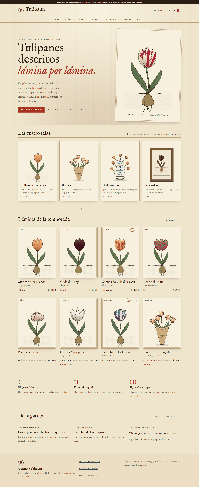

## Lo que hace

- **Catálogo por salas**, con familias, búsqueda y orden por número de lámina o precio.
- **Láminas generadas**: espécimen botánico con bulbo y raíces, ramo en papel de estraza, tulipanera escalonada pintada en esmalte, grabado enmarcado.
- **Encargo** (carrito) que el servidor vuelve a cotizar en cada cambio; los precios nunca salen del navegador.
- **Pagaré simulado**: el pago no pide datos de tarjeta ni usa pasarela. Quien compra elige aprobar o rechazar, y el servidor decide si el encargo puede cambiar de estado.
- **Seguimiento** del encargo (registrado → pagado → en preparación → despachado → entregado) con recibo sellado.
- **Notas de jardín**: solo quien ya recibió una lámina puede reseñarla, una vez.
- **Libro del taller** (`/admin`): resumen de ingresos, encargos por estado, existencias bajas, gestión de encargos, compositor de láminas, clientes y moderación de notas.
- **Gaceta** con notas de cultivo e historia, y formulario para escribir al taller.
- **Correo local**: recibos, avisos de despacho y recuperación de contraseña llegan a un buzón de pruebas (Mailpit). Nada sale de la máquina.

## Capturas

| | |
|---|---|
| 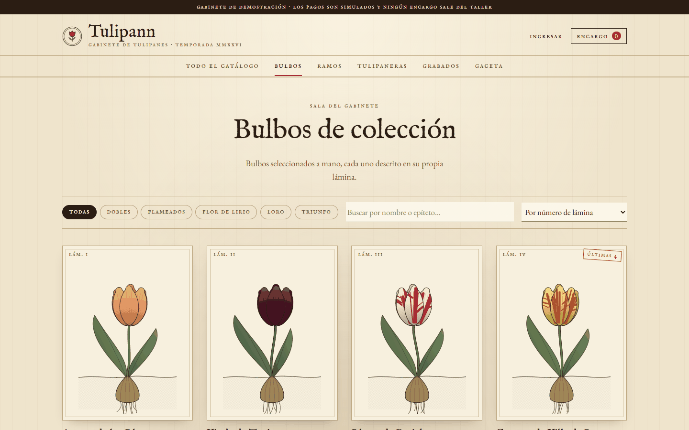 | 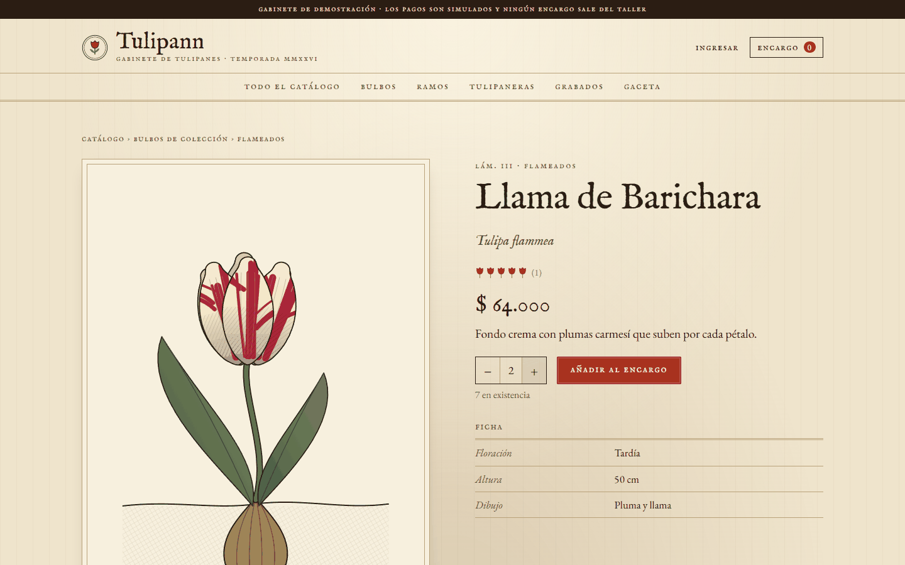 |
| Sala de bulbos | Página de una lámina |
| 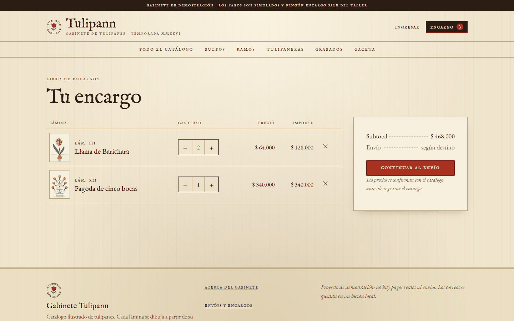 | 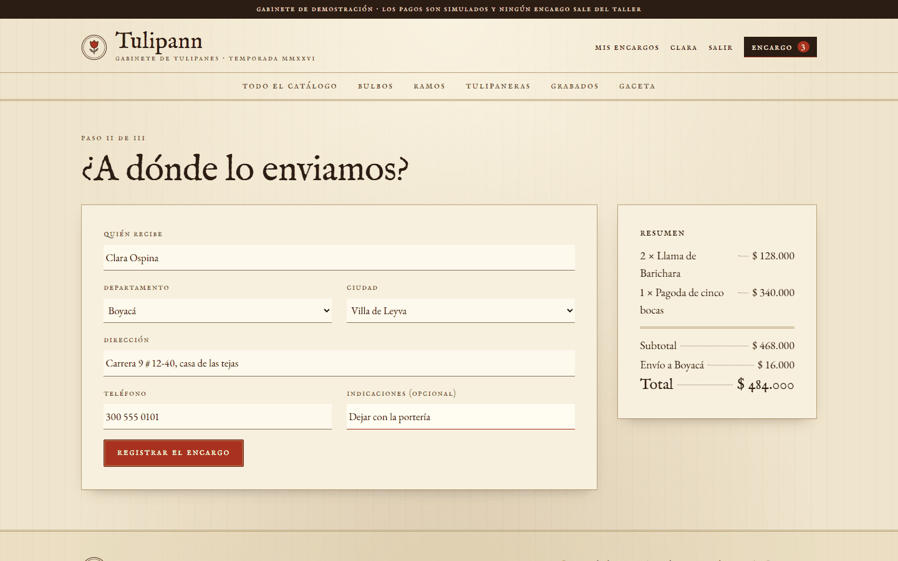 |
| El encargo | Datos de envío |
| 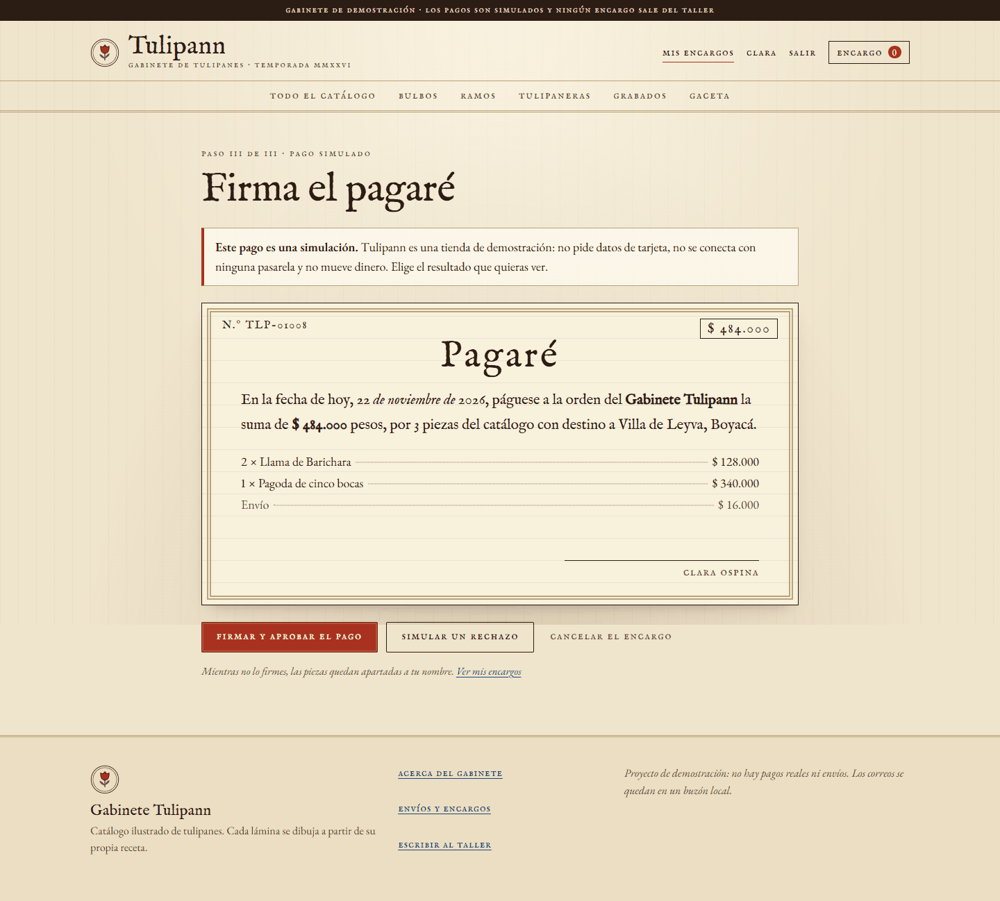 | 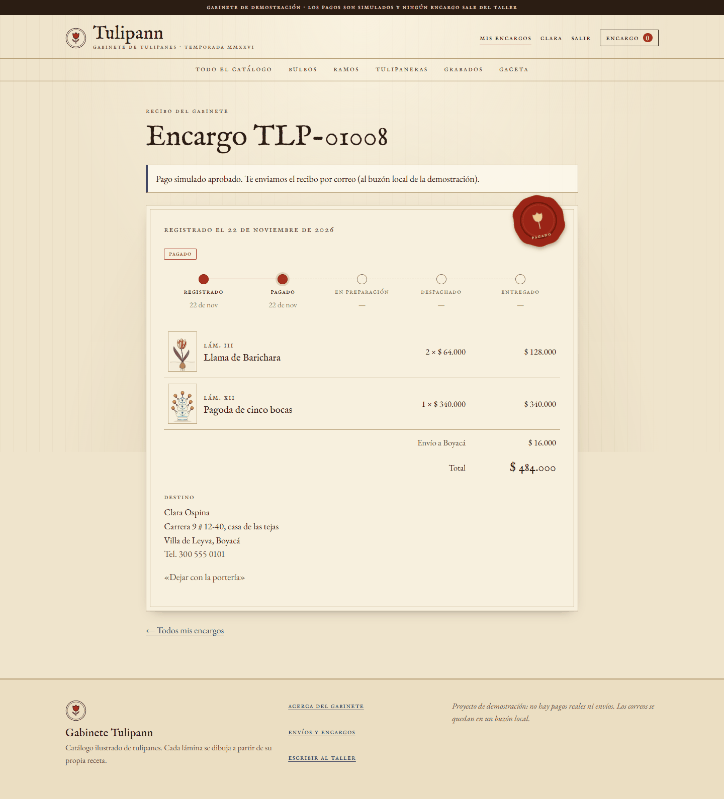 |
| Pagaré simulado | Recibo sellado |
| 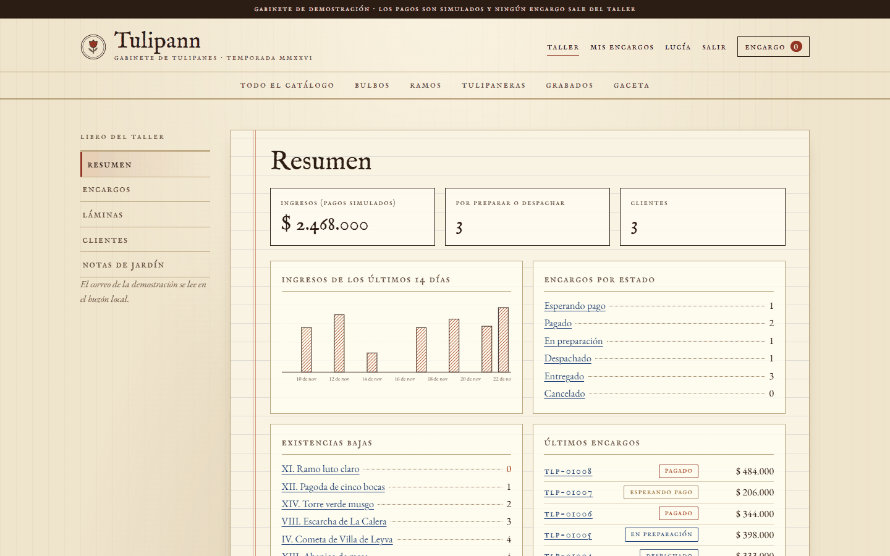 | 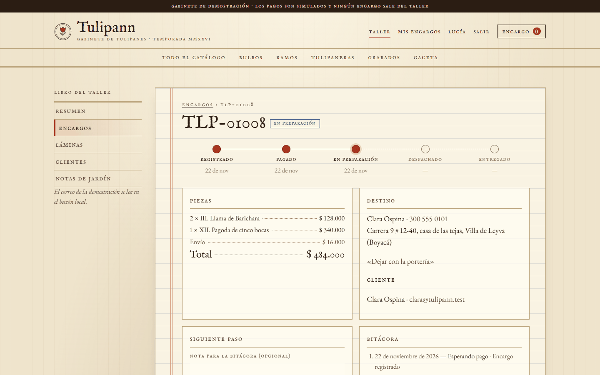 |
| Libro del taller | Un encargo visto por el taller |
| 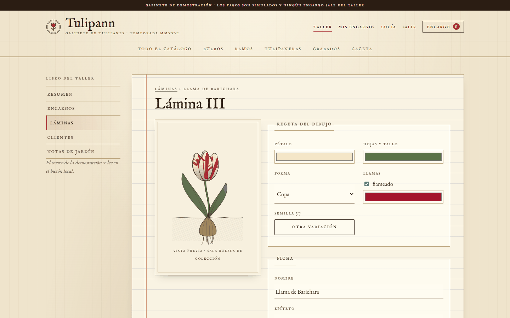 | 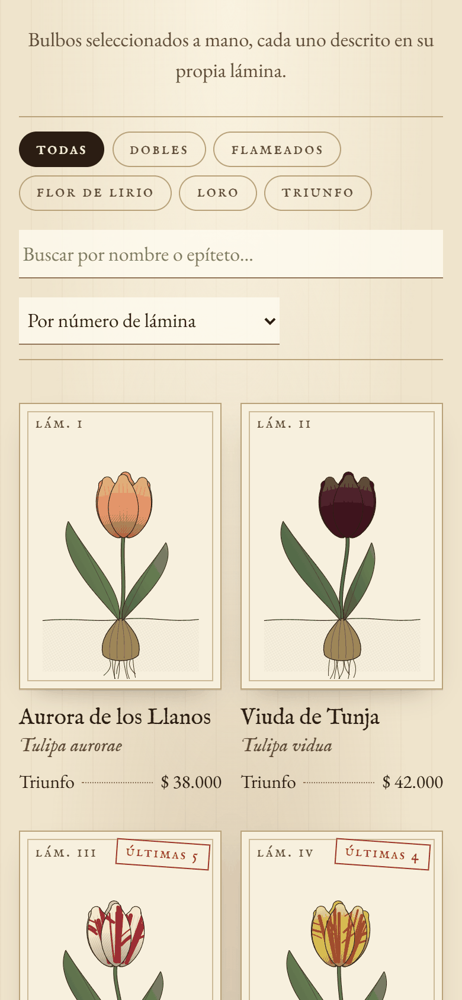 |
| Compositor de láminas | Vista móvil |

## Cómo ejecutarlo

Requisito: Docker con Compose.

```bash
docker compose up --build
```

- Tienda: <http://localhost:8160>
- Buzón de correo (Mailpit): <http://localhost:8161>

La primera vez se crean las tablas y se cargan los datos de demostración: catálogo, clientes, encargos en distintos estados, notas y gaceta. Para empezar de cero: `docker compose down -v`.

### Cuentas de demostración

| Rol | Correo | Contraseña |
|---|---|---|
| Taller (administración) | `taller@tulipann.test` | `Taller.2026` |
| Cliente | `clara@tulipann.test` | `Cliente.2026` |
| Cliente | `tomas@tulipann.test` | `Cliente.2026` |
| Cliente | `ines@tulipann.test` | `Cliente.2026` |

### Desarrollo sin Docker

```bash
# API (Python 3.13)
cd backend
python -m pip install --require-hashes -r requirements.txt -r requirements-dev.txt   # dentro de un entorno virtual
export DJANGO_SECRET_KEY=solo-local DJANGO_DEBUG=1
python manage.py migrate && python manage.py seed_demo
python manage.py runserver 8000

# Tienda (Node 24+)
cd frontend
npm ci
npm run dev    # http://localhost:5173, con /api redirigido a :8000
```

Sin `EMAIL_HOST`, los correos se imprimen en la consola de la API. Sin `DATABASE_URL`, se usa SQLite.

## Pruebas

```bash
cd backend && python -m pytest        # catálogo, encargo y pago, estados, autenticación, permisos
cd frontend && npm test               # generador de láminas, encargo, ingreso, pago simulado
cd frontend && npm run build
```

La integración continua (`.github/workflows/tests.yml`) ejecuta lo mismo en cada cambio.

## Arquitectura

```
frontend/   React + Vite + TypeScript. Una sola aplicación: tienda y libro del taller (/admin).
  src/art/    Generador de láminas (geometría pura + render SVG).
backend/    Django + Django REST Framework.
  catalog/    Salas, familias, láminas y notas de jardín.
  orders/     Departamentos, encargos y su ciclo de vida (orders/services.py).
  accounts/   Usuarios y sesión.
  journal/    Gaceta.   contact/  Cartas al taller.
docker-compose.yml   PostgreSQL, API (gunicorn), nginx con la tienda y Mailpit.
```

- La tienda y la API comparten origen (nginx reenvía `/api`). La sesión vive en una cookie `HttpOnly` y cada petición que modifica datos lleva el token CSRF; el navegador no guarda ningún token.
- Todo cambio de estado de un encargo pasa por `orders/services.py`, que valida quién lo pide y qué transición está permitida. Las existencias se apartan al registrar el encargo y se devuelven si se cancela.
- La tienda y la administración son una sola aplicación porque comparten diseño, sesión y componentes (las láminas, el sello, la línea de estados); separarlas duplicaba todo eso.

## Contexto

Tulipann fue uno de mis primeros proyectos: una tienda de comercio electrónico construida en 2022–2023 con un panel de administración aparte y una API en Django que dependía de servicios externos (pasarela de pagos, almacenamiento de imágenes, envío de correo y listas de suscripción). Esos servicios ya no existen para este proyecto, así que en 2026 lo reconstruí como una obra autocontenida: mismo propósito y mismas funciones, ahora con identidad propia, pago simulado, correo local, pruebas automáticas y un solo comando para ejecutarlo.

La versión original la desarrollé junto con **Mateo** ([@JhMateo](https://github.com/JhMateo)), coautor de la API original en Django.

## Licencia

[MIT](LICENSE) © 2022–2026 Kevin Martinez.
